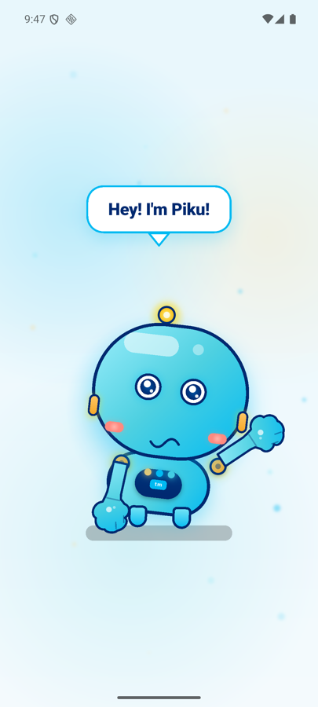
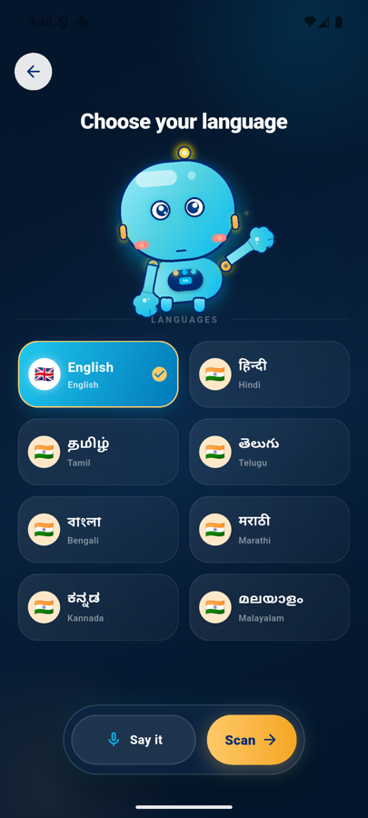
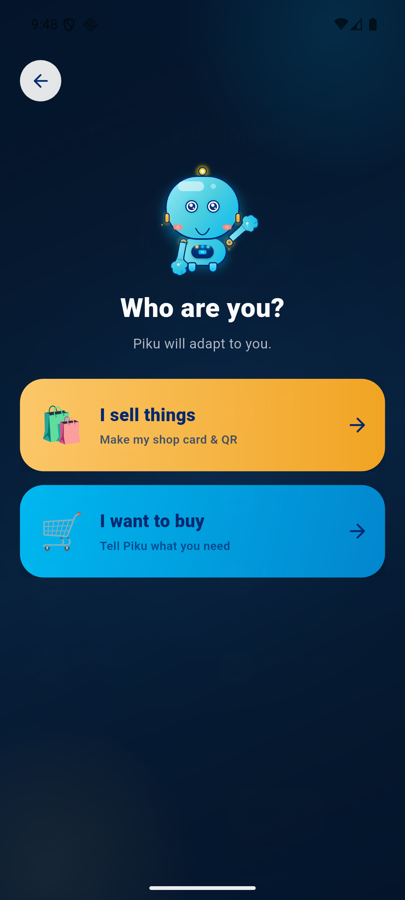
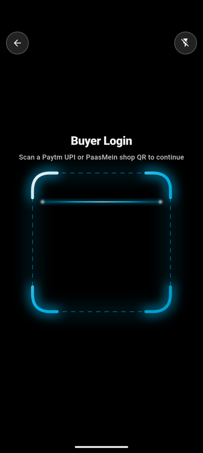

# PaasMein

**A voice-first local marketplace that connects nearby buyers and merchants.** Meet Piku, choose a language, find a shop, and use ONIT to ask about products and negotiate directly.

<p align="center">
  
  &nbsp;&nbsp;
  
  &nbsp;&nbsp;
  
  &nbsp;&nbsp;
  
</p>

## What’s inside

- **Buyer and seller journeys** in a Flutter app, with multilingual onboarding.
- **Nearby shop discovery** with a map and published shop cards.
- **ONIT voice conversations** for buyers to ask a merchant questions and negotiate.
- **Buyer web experience** in [`web/market.html`](web/market.html), backed by the local Flask API in [`web/server.py`](web/server.py).

## Run the Flutter app

Install Flutter and Android Studio, connect an Android device or start an emulator, then run:

```sh
flutter pub get
flutter run
```

OpenAI-powered features can be enabled for local development by passing a key at runtime:

```sh
flutter run --dart-define=OPENAI_API_KEY=your-key
```

Keep API keys out of source control.

## Run the buyer website and API

See [`web/README.md`](web/README.md) for setup instructions. The Flask server must be reachable from both the browser and phone; use your computer’s LAN IP instead of `localhost` in the phone app.

## Screenshots

These screens were captured from the app running on an Android emulator.
